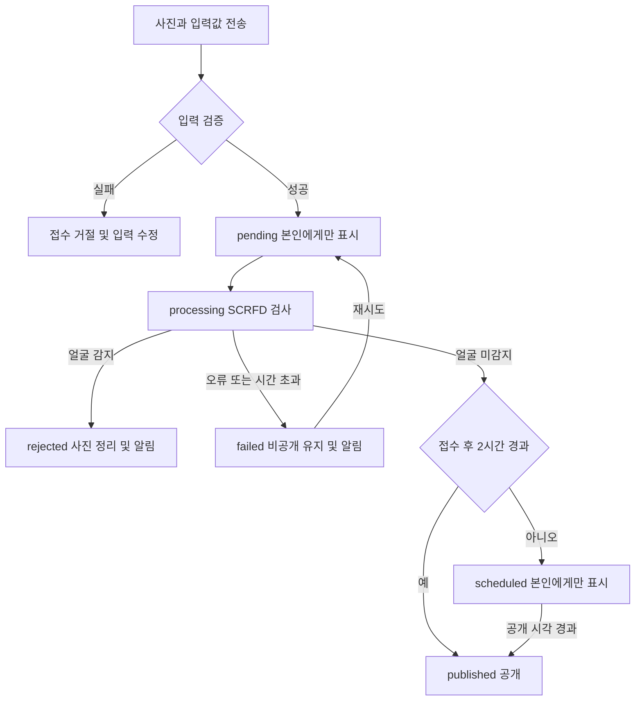

# 가까이 제품 요구사항

작성일: 2026-10-29 · 버전: 0.1 · 상태: 팀 검토용 초안

가까이(가제)는 동네에서 발견한 장소와 순간을 사진, 짧은 글, 위치로 남기고 다른 사람과 공유하는 모바일 서비스다. 얼굴 노출을 줄이기 위해 사진을 서버에서 검사하고, 검사 통과와 공개 대기 시간 경과를 모두 확인한 후 다른 사용자에게 공개한다.

이 문서는 앱 전체의 기획 맥락과 **현재 저장소가 담당하는 사진 검사·공개 기능**을 구분한다. 서버 실행 및 API 계약은 [README](README.md)를 따른다.

## 1. 문제와 목표

동네 사진에는 배경 행인 등 다른 사람의 얼굴이 의도치 않게 포함될 수 있다. 사진을 공개하기 전에 검사해야 하지만, 저사양 서버의 검사 시간을 사용자가 업로드 화면에서 계속 기다리게 하면 사용성이 떨어진다. 기록을 즉시 공개하면 사용자의 현재 위치가 드러날 수도 있다.

목표는 다음과 같다.

- 검사에서 얼굴이 감지된 사진을 공개하지 않는다.
- 접수된 기록은 작성자의 ‘내 기록’에 먼저 표시해 검사 중에도 앱을 계속 사용할 수 있게 한다.
- 검사 통과와 접수 후 2시간 경과를 모두 만족한 기록만 공개한다.
- 거절과 검사 장애를 구분해 사진 재선택 또는 재시도를 안내한다.
- 프론트와 기존 로그인 서버가 연결할 수 있는 Python API를 제공한다.

얼굴 감지는 개인의 신원을 알아내는 얼굴 인식과 다르다. 얼굴 미감지는 사람이나 개인정보가 전혀 없다는 보장이 아니다. 사용자 안내는 ‘얼굴이 감지되지 않았어요’로 표현한다.

## 2. 대상 사용자와 사용 상황

| 사용자 | 필요 | 대표 상황 |
|---|---|---|
| 기록 작성자 | 장소와 순간을 빠르게 남기기 | 촬영 후 제목·코멘트·태그·위치를 확인하고 기록 완료 |
| 동네 탐색자 | 다른 사람이 남긴 장소 찾아보기 | 지도·리스트에서 공개된 기록을 탐색 |
| 프론트 개발자 | 업로드·검사 상태·알림 연결 | API 상태에 따라 카드, 안내창, 재시도 버튼 표시 |
| 서버 개발자 | 권한·저장·검사 작업 운영 | 로그인 연동, 비공개 저장, 작업자 실행 및 장애 대응 |

## 3. 화면 플로우와 구현 경계

기준: [Figma 화면 플로우](https://www.figma.com/board/YX8vXop3PBcVwlanU6hRWG/?node-id=11-3138)

| 화면 영역 | 기획 기능 | 현재 저장소의 역할 |
|---|---|---|
| 온보딩 | 로그인, 위치·사진 권한, 사용자 기호 조사 | 기존 인증과 연결할 인터페이스만 제공 |
| 홈 지도 | 장소·태그 검색, 사진 탐색, 경로 추천 | 공개된 기록 목록과 위치 정보 제공 |
| 기록 생성 | 촬영 → 한 줄 남기기 → 최종 위치 확인 | 최종 사진과 입력값 접수, 검사 및 공개 판단 |
| 내 기록 | 본인 기록을 지도·리스트로 조회, 상세 열기 | 검사 중·공개 대기·공개·거절·오류 기록 조회 |
| 마이 알림 | 사용자 알림 확인 | 검사 결과 알림 조회·읽음 처리 |

**이번 구현에 포함되지 않는 기능:** React Native/Expo 화면, 실제 로그인·회원가입, 지도 렌더링, 거리 기반 사진 잠금 해제와 흐림 처리, 장소 검색, AI 해시태그 생성, 경로 추천, 좋아요, 신고, AI 리포트, OS 푸시 알림.

현재 공개 목록에는 거리·지역 필터가 없고, 공개된 사진은 인증된 사용자가 이미지 API로 볼 수 있다. Figma의 ‘가까이 가야 사진이 열리는’ 경험을 제공하려면 별도의 위치 확인·접근 정책을 서버에 추가해야 한다. 공개 목록을 제한하는 프론트 처리만으로는 이를 보장할 수 없다.

## 4. 사용자 흐름

1. 사진 한 장을 촬영하거나 선택한다. 사진 선택 UI는 프론트가 담당한다.
2. 제목, 한 줄 코멘트, 선택한 해시태그를 입력한다.
3. 위치를 확인하고 기록 완료를 누른다.
4. 프론트는 전송 중임을 표시한다. 서버 접수 전 로컬 미리보기를 보여주는 것은 가능하지만 공개 완료로 안내하지 않는다.
5. 서버는 사진을 비공개로 보관하고 `202 Accepted`와 기록 ID를 반환한다.
6. 내 기록에 ‘검사 대기/검사 중 · 나에게만 보여요’를 표시한다.
7. 작업자가 SCRFD로 사진을 검사한다.
8. 검사 결과에 따라 공개 대기, 공개, 거절 또는 오류로 상태가 바뀐다.
9. 프론트는 상태와 알림을 조회해 화면에 반영한다. 앱을 다시 열면 내 기록과 미확인 알림을 다시 조회한다.

## 5. 기능 요구사항

| ID | 요구사항 | 현재 상태 |
|---|---|---|
| FR-01 | 최종 사진 1장과 제목·코멘트·위치·태그를 접수한다 | 구현 |
| FR-02 | 서버가 인증한 사용자만 작성자로 지정한다 | 테스트 토큰 구현, 실제 로그인 연결 필요 |
| FR-03 | 접수 후 검사 완료를 기다리지 않고 기록 ID를 반환한다 | 구현 |
| FR-04 | 미검사·검사 중·공개 대기·오류 기록은 소유자만 조회한다 | 구현 |
| FR-05 | SCRFD-10G로 검사하고 얼굴이 하나라도 감지되면 거절한다 | 구현 |
| FR-06 | 검사 통과와 공개 시각 경과를 모두 만족해야 공개한다 | 구현 |
| FR-07 | 공개 여부를 목록·상세·이미지 경로 모두에서 확인한다 | 구현 |
| FR-08 | 검사 결과 알림을 저장하고 사용자별로 조회·읽음 처리한다 | 구현, 프론트 표시 연결 필요 |
| FR-09 | 검사 장애는 승인으로 처리하지 않고 재시도를 제공한다 | 구현 |
| FR-10 | 동일 요청의 통신 재시도로 중복 기록이 생기지 않게 한다 | 구현 |
| FR-11 | 작업자 재시작 시 중단된 검사 작업을 복구한다 | 구현 |
| FR-12 | 거절 사진과 만료된 미검사 사진을 비공개 저장소에서 정리한다 | 구현 |

### 입력 정책

| 항목 | 기준 |
|---|---|
| 사진 | JPEG/PNG/WebP 정지 이미지 한 장, 10MiB 이하 |
| API 입력 픽셀 수 | 최대 16,000,000픽셀; 프론트에서는 긴 변 최대 1920px로 전송 권장 |
| 제목 | 필수, 1~10자 |
| 코멘트 | 필수, 1~40자 |
| 해시태그 | 선택, 최대 3개, 각 1~30자, 중복 불가 |
| 위치 | 위도 -90~90, 경도 -180~180, 필수 |
| 요청 식별자 | 프론트에서 생성한 UUID; 동일 사진·입력값 재전송 시 재사용 |

위치는 프론트가 보낸 좌표의 범위만 검사한다. 실제 촬영 장소, 촬영 시각 또는 사용자의 현장 방문 여부를 검증하는 기능은 없다. 얼굴 검사는 포스터·화면·거울 속 얼굴에도 동일하게 적용하며, 자동 모자이크 후 공개는 지원하지 않는다.

### 검사와 저장 정책

- 모델: SCRFD-10G, 감지 임계값 0.5.
- 검사: 긴 변 최대 1920px와 320px 축소본을 각각 검사하고 결과를 합친다. 작은 입력을 확대하지 않는다.
- 저장: 검사에 사용한 이미지에서 긴 변 최대 1080px, JPEG 품질 90으로 변환한다.
- 공개 이미지는 서버 검사 경로가 만든 JPEG만 사용한다. 사용자에게 원본 공개 업로드 권한을 별도로 주지 않는다.
- 방향 보정은 EXIF를 반영하고, 저장 JPEG 재인코딩 시 EXIF 메타데이터를 전달하지 않는다. 기록의 위치 정보는 별도 DB 필드로 보관한다.
- 얼굴 비교, 신원 식별, 얼굴 임베딩 저장은 하지 않는다.

## 6. 상태와 공개 규칙

| API 상태 | 의미 | 조회 범위 | 프론트 처리 |
|---|---|---|---|
| `pending` | 검사 대기 | 본인 | 대기 안내, 3초 후 상태 조회 |
| `processing` | 검사 중 | 본인 | 검사 중 안내, 3초 후 상태 조회 |
| `scheduled` | 검사 통과, 공개 시각 전 | 본인 | 공개 예정 시각 표시, 60초 후 조회 |
| `published` | 검사 통과, 공개 시각 경과 | 다른 사용자에게 공개 가능 | 공개 완료 표시 |
| `rejected` | 얼굴 감지, 손상 파일 또는 보관 만료 | 본인에게 상태만 제공 | 사유 안내, 새 사진으로 접수 |
| `failed` | 검사 장애 또는 시간 초과 | 본인 | 오류 안내, 재시도 제공 |

기본 `publish_at`은 **서버 접수 시각 + 7,200초**다. 검사가 더 오래 걸리면 통과 시점까지 비공개다. `publish_at`이 지나도 `pending`, `processing`, `rejected`, `failed`는 공개되지 않는다.

DB는 통과 상태를 `approved`로 저장한다. API는 요청 시 현재 시각에 따라 이를 `scheduled` 또는 `published`로 변환하므로, 공개 시각마다 DB를 수정하는 별도 스케줄러는 필요하지 않다.

테스트에서는 `FACE_PUBLIC_DELAY_SECONDS=0`으로 통과 즉시 공개를 확인할 수 있다. 운영 기본값은 2시간이다.

## 7. 오류와 알림

- 접수 단계의 잘못된 입력은 HTTP 오류로 즉시 반환한다.
- `202`를 받은 뒤 발생한 얼굴 감지는 HTTP 업로드 오류가 아니라 기록의 `rejected` 상태와 `FACE_DETECTED` 알림으로 전달한다.
- 검사 장애와 시간 초과는 `failed`로 남긴다. 통신 장애와 얼굴 감지를 같은 메시지로 표시하지 않는다.
- 알림은 사용자별 DB 기록이다. 앱이 닫혀 있어도 보관되며, 재접속 시 조회할 수 있다. 현재 OS 푸시 전송 기능은 없다.
- 검사 통과 시 `scheduled` 또는 `published` 알림을 생성한다. `scheduled`가 시간 경과로 공개되는 순간에 추가 알림을 만들지는 않는다.
- 재시도는 실패한 동일 사진을 다시 검사한다. 사진이나 입력값 변경은 새 UUID로 새 기록을 접수한다.

## 8. 운영 조건

배포 후보는 AWS EC2 `t2.micro`다. 아직 AWS 배포·성능 검증은 완료하지 않았으며, 로컬 CPU 제한 측정값을 AWS 처리 시간으로 보장하지 않는다.

| 항목 | 현재 기준 |
|---|---|
| API | FastAPI, Uvicorn 작업 프로세스 1개 |
| 검사 | 별도 작업자 1개가 모델 자식 프로세스를 재사용하며 순차 처리 |
| 저장 | 동일 서버의 비공개 디렉터리와 SQLite |
| 동시 업로드 | API 프로세스당 최대 2개 |
| 대기량 제한 | `pending`·`processing`·`failed` 합계 사용자당 3개, 전체 50개 |
| 검사 제한 시간 | 모델 초기화 60초, 사진 검사 응답 대기 45초 |
| 장애 복구 | 중단된 `processing` 작업을 작업자 시작 시 `pending`으로 복구 |
| 파일 정리 | 통과·거절 원본 정리; 접수 후 24시간 지난 `pending`·`failed` 사진 만료 처리 |

만료 정리는 작업자가 시작할 때와 실행 중 약 60초 간격으로 수행한다. 작업자가 정지한 동안에는 만료 파일 삭제도 지연된다. 게시 이미지·기록 메타데이터·알림의 장기 보관과 사용자 삭제 정책은 별도 결정이 필요하다.

공개 가중치의 이용 조건은 출시 전에 확인해야 한다. [InsightFace 공식 라이선스 안내](https://github.com/deepinsight/insightface#license)는 공개 학습 데이터와 모델을 비상업 연구용으로 제한한다. 해커톤이라는 이유만으로 모든 이용이 허용되는 것으로 간주하지 않는다.

## 9. 검증과 완료 기준

현재 저장소에는 감지 테스트 7개, API·작업자 테스트 14개가 있고 기존 로컬 검증에서 모두 통과했다. 기능 테스트 통과는 실제 동네 사진 전체에 대한 정확도 보장이 아니다.

| 검증 | 완료 기준 | 확인 상태 |
|---|---|---|
| 비공개 접근 | 다른 사용자가 대기 기록의 ID·이미지 URL을 알아도 접근 불가 | 로컬 테스트 통과 |
| 검사 성공 | 얼굴 미감지 사진의 서버 생성 JPEG만 공개 경로에서 제공 | 로컬 테스트 통과 |
| 공개 지연 | 검사 통과 전 또는 공개 시각 전에는 다른 사용자에게 비공개 | 로컬 테스트 통과 |
| 얼굴 감지 | 사진 비공개, 원본 정리, 본인 알림 생성 | 로컬 테스트 통과 |
| 장애 | 예외·시간 초과·모델 종료를 승인으로 처리하지 않음 | 로컬 테스트 통과 |
| 복구 | 재시도·중복 접수 방지·작업자 재시작 후 재처리 | 로컬 테스트 통과 |
| 앱 연결 | 실제 기기에서 사진 선택부터 상태·알림 반영까지 동작 | 미완료 |
| 배포 | AWS에서 반복·연속 요청 시간, 메모리, CPU 크레딧 확인 | 미완료 |

출시 판단에 사용할 지표는 얼굴 있는 사진의 잘못된 통과율, 얼굴 없는 사진의 잘못된 차단율, 접수 응답 시간, 대기열 포함 검사 완료 시간의 중앙값·95백분위, 최대 메모리, 검사 장애율이다. 허용 기준은 실제 동네 사진과 대상 서버 측정 후 팀이 정한다.

## 10. 팀 연결 작업

| 담당 | 남은 작업 |
|---|---|
| 기존 백엔드 | 실제 로그인 토큰 검증과 사용자 ID 연결, HTTPS, 프로세스 재시작·저장소 운영 |
| 프론트 | 전송 중과 검사 중 구분, 내 기록 표시, 상태 조회, 인증 헤더를 포함한 이미지 표시, 알림·재시도 연결 |
| 모델 담당 | 실제 사진의 누락·오탐 검증, 감지 기준 조정, 서버 성능 측정 |
| 제품·디자인 | 거리별 사진 열기 정책, 공개·실패 기록의 UX, 장기 보관·삭제 정책 확정 |

기존 [1차 인수인계](HANDOFF.md), [2차 인수인계](HANDOFF_FACE_DETECTION.md)는 이전 논의와 실험 기록이다. 동기식 게시 API 초안이나 미정 모델 선택 등 현재 구현과 다른 내용은 이 문서와 README의 현재 계약을 우선한다.
